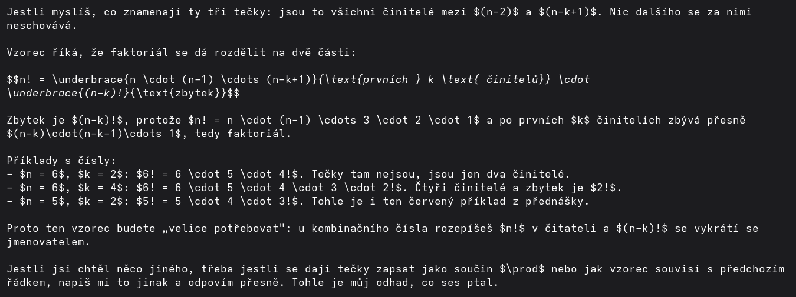
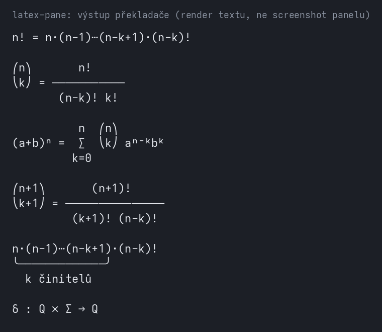

# claude-math-mod

Mod pro Claude Code (`latex-pane`), který v boční části rozhraní ukáže LaTeX z poslední odpovědi jako čitelný Unicode. Terminál LaTeX sám nevykreslí, takže bez modu je v chatu vidět surový text.

## Před a po

| Bez modu (surový LaTeX v chatu) | S modem (výstup překladače) |
|---|---|
|  |  |

Obrázek „po" je render textu, který vrací překladač (`texToUnicode`), ne screenshot panelu ve skutečném terminálu. Vzhled panelu v reálném UI zatím nikdo neověřil. Pro srovnání je v `docs/obsidian-vzorec.png` stejný vzorec vykreslený v Obsidianu.

## Použití

- Po každé hlavní odpovědi (ne subagentů) mod najde `$…$`, `$$…$$`, `\[…\]`, `\(…\)` a `\begin{equation|align|gather}`; kód a code-fence přeskakuje.
- Panel „LaTeX" se jednou za session otevře sám. `/tex` ho otevře znovu, `/tex <vzorec>` zobrazí zadaný text.
- Zapnutí: `claude --plugin-dir ./latex-pane`, nebo zkopírovat složku `latex-pane` do složky modů Claude Code.

## Co umí a neumí

Umí zlomky na dva řádky (úzký panel přejde na `(a)/(b)`), `\binom`, `\sum` a `\prod` s mezemi, horní a dolní indexy, `\underbrace`/`\overbrace`, řecká písmena, relace a operátory, `\sqrt`, `\text`, `\mathbb`. Rozbitý vstup panel nesundá, ukáže se původní text.

Neumí matice, `cases` a `align` jinak než jako řádky pod sebou, `\left`/`\right` se ignorují, akcenty (`\hat`, `\vec`) se vypíšou jako text (`\hat x`). Známá zjednodušení jsou v kódu označená komentářem `shortcut:`. Příliš hluboce vnořené zlomky a vzorce nad 4000 znaků se zobrazí jako původní text; z odpovědi se hledá jen prvních 50 000 znaků. Písmo bez znaků ⎛ ⎝ ∑ ⁿ ᵏ rozhodí 2D zápis (v obrázku výše jsou proto použité znaky z Adwaita Mono).

## Test

```
node --experimental-strip-types latex-pane/latex.selftest.ts
```

Napsal Claude (Sonnet 5.5) na zadání Zdeňka Toušky; vývoj a ověření proběhly 31. 10. 2026.

## Licence

MIT, viz [LICENSE](LICENSE).
